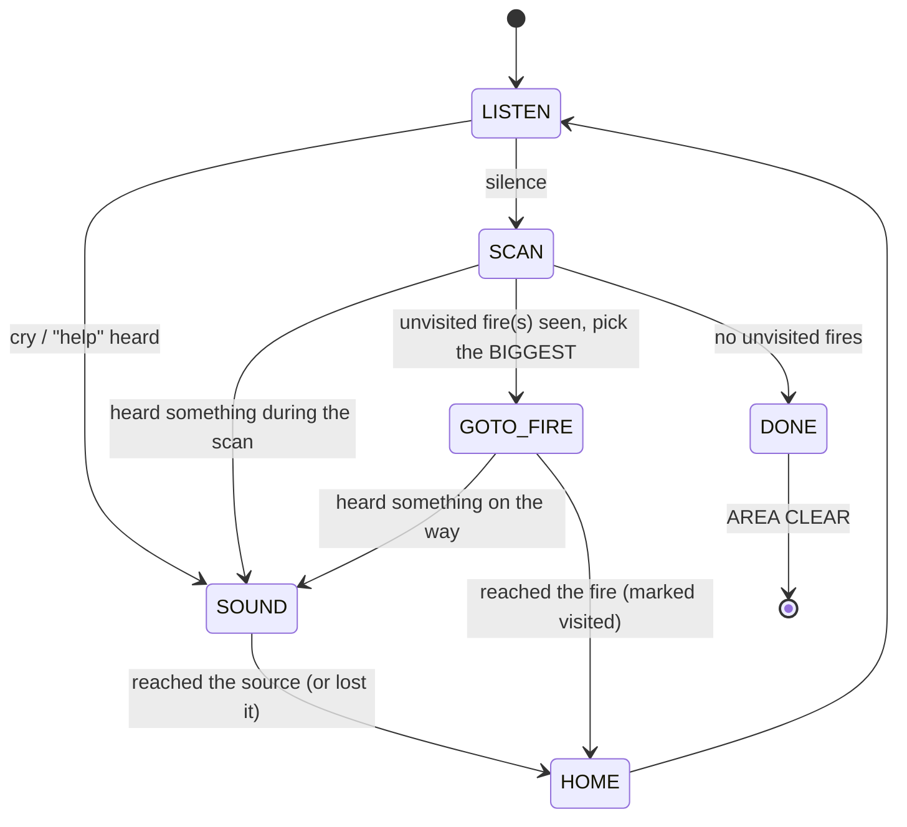

# FinalProjSSE: Rescue Robot

Smart Systems Engineering final project (VU Amsterdam, 2026).
Team: Joan Carles Codorníu, Guilherme Hahn Royer, Teije Rijswijk.

A LEGO MINDSTORMS EV3 robot with a webcam that searches a room after a (simulated) disaster:

- It **listens** for a child crying, a scream, or someone shouting **"help"**, and drives to the sound.
- It **looks** for fires (our printed cartoon flame, `data/images/fire_template.jpg`), recognises them by **colour layers and shape**, estimates their **real size and position**, and drives to the **biggest** one.
- **Sound has priority** over fire. A cry interrupts whatever the robot is doing.
- It builds a **live map** of its path, the obstacles it sees with the ultrasonic sensor, the fires, and the sound sources.
- After each fire or sound it **returns home** and starts again, until the area is clear.

All processing runs in MATLAB on a laptop. The EV3 drives the motors and reads its sensors; the webcam plugs straight into the laptop.

```
Webcam (video + mic) ──USB──►  MATLAB (laptop)  ◄──USB/Bluetooth──  EV3: motors, gyro, ultrasonic
```

---

## How the robot behaves



The robot can't hear while its motors run, so it works in **stop-and-go cycles**. It stops at every scan step and every driving segment to listen. That's also what gives sound its priority.

---

## Repository structure

```
FinalProjSSE/
├── main.m              the mission: state machine above
├── config.m            ALL settings and thresholds (edit only here)
├── setup.m             adds the folders to the MATLAB path
├── sound/              hearing
│   ├── extract_features.m, classify_window.m   stage 1: rule-based cry/scream detector
│   ├── word_features.m, dtw_distance.m         stage 2: "help" by MFCC + template matching (DTW)
│   ├── band_level.m, listen_once.m             runtime: loudness + both detectors at once
│   ├── record_takes.m                          record labelled clips into data/sound/
│   ├── evaluate_rules.m                        tune + confusion matrix for stage 1
│   ├── help_train_evaluate.m                   build templates, choose threshold, confusion matrix
│   └── live_test.m, live_help.m                live demos with plots (FFT, spectrogram, MFCC)
├── vision/             seeing
│   ├── fire_mask.m                             HSV colour mask (red, orange, yellow) + cleaning
│   ├── fire_template.m                         flame silhouette template (built from the printed picture)
│   ├── fire_features.m, classify_fire.m        rule-based detector: shape match + colour layers
│   ├── detect_fire.m, grab_frame.m             camera -> detection, confirmed over 2 of 3 frames
│   ├── fire_geometry.m                         direction and REAL size of a fire
│   ├── live_fire.m                             live demo + collect labelled images (keys f / n)
│   └── evaluate_fire.m                         tune + confusion matrix
├── robot/              moving (EV3)
│   ├── robot_init.m, robot_shutdown.m          connect / disconnect everything
│   ├── drive_distance.m                        drive straight with gyro correction + odometry
│   ├── turn_to.m, turn_by.m                    turn on the spot (P-controller on the gyro)
│   ├── read_distance.m, get_heading.m          ultrasonic sensor, gyro
│   └── check_stop.m, stop_motors.m, ...        safety (STOP button)
├── behaviours/         what the robot does
│   ├── scan_for_fires.m                        360 degree scan: listen, map, detect, measure fires
│   ├── approach_fire.m                         drive to a fire, stop in front of it
│   ├── follow_sound.m                          stop-and-scan sound direction, drive to the source
│   └── go_home.m                               return to the start position
├── mapping/            the live map + logging
├── tools/              calibration and tests (run these first, see below)
├── data/sound/{help,nothelp,cry,other}/        recordings (.wav)
├── data/images/{fire,nofire}/                  camera images (.png)
├── models/help_model.mat                       "help" templates + threshold (generated)
└── results/                                    map picture + log of every run (generated)
```

---

## Requirements

- MATLAB (R2021a or newer)
- Toolboxes: **Signal Processing**, **Image Processing**
- Support packages (Home → Add-Ons): **MATLAB Support Package for USB Webcams**, **MATLAB Support Package for LEGO MINDSTORMS EV3 Hardware**
- Hardware: EV3 brick with two large motors (ports B, C), **gyro sensor** (port 2), **ultrasonic sensor** (port 4), and a Microsoft LifeCam Cinema mounted above the ultrasonic sensor, both facing forward. You can change the ports in `config.m`.

---

## Getting started (in this order)

Open MATLAB **in the repository folder** and run `setup` once per session.

### 1. Robot calibration: `tools/test_ev3.m`
This checks the sensors, drives 0.50 m and turns 90°. Then fix in `config.m`:
- `C.ev3.motorSign`: set to `-1` if the robot drove backwards
- `C.ev3.wheelDiameter`: scale it by (real distance ÷ 0.50)
- `C.ev3.gyroSign`: flip it if the robot turned right, or kept spinning

### 2. Sound
1. Pick the LifeCam microphone: run `audiodevinfo`, find the LifeCam's input ID, and set `C.sound.micID`.
2. Record data with `sound/record_takes.m`, into these folders:
   - `help`: "help", spoken **and** screamed
   - `nothelp`: "hello", "hell", "yelp", "hey", screams without words, talking, motor noise
   - `cry` and `other`: for the stage 1 rules (ESC-50 "crying baby" clips work too)
3. Train the "help" detector with `sound/help_train_evaluate.m`. It writes `models/help_model.mat` and shows the confusion matrix.
4. Tune stage 1 with `sound/evaluate_rules.m`: use the box plots to set `C.sound.cryRules`.
5. Calibrate loudness with `tools/sound_level_meter.m`: set `C.sound.minLevel` and `C.sound.closeLevel`.

### 3. Vision
1. Collect images with `vision/live_fire.m`. Click the window and press **f** when a fire is in view, **n** when not. Include other red and orange objects in the "n" images.
2. Tune and evaluate with `vision/evaluate_fire.m`: use the box plots to set `C.fire.rules`.
3. Measure the camera's field of view with `tools/measure_fov.m`, and set `C.camera.hfov`.

### 4. Test a scan: `tools/test_fire_scan.m`
Put the big and small fire around the robot. It should find both, at roughly the right positions, and report the big one as bigger.

### 5. Full mission: `main`
Keep the robot still while it connects (the gyro calibrates). Press the red **STOP** button on the map, close the map, or press Ctrl+C to stop. Every run is saved in `results/run_<time>/` (map.png, log.txt, run.mat).

---

## How it works (so we can explain it)

**Stage 1: cry/scream (rule-based).** The recording is cut into 32 ms frames. Each frame gets a Hamming window and an FFT. Five features are computed per 1 s window:
- loudness
- dominant frequency (250–4000 Hz)
- spectral flatness (tonal or noise)
- how much of the window is cry-like (sustained)
- share of energy in 250–4000 Hz

It's a cry only if all five rules pass.

**Stage 2: "help" (template matching).** The word is cut out by energy, and MFCCs are computed (FFT → mel filterbank → log → DCT). The word is compared with recorded "help" templates using **Dynamic Time Warping**, which lines up words spoken at different speeds. It counts as "help" if the smallest distance is at or below a threshold chosen on separate tuning files.

**Sound direction.** One microphone can't hear direction, so the robot **stops and turns**, measures loudness at each heading (300–3000 Hz), and drives toward the loudest one. It repeats this every 0.5 m.

**Fire detection (rule-based + template matching).** Colour alone isn't enough: any red object would pass. So the detector checks what makes *our* flame unique.
1. RGB → HSV, then keep red, orange and yellow pixels that are saturated and not dark. White paper, walls and shadows drop out.
2. Opening and closing, then fill holes, so the flame becomes one solid silhouette.
3. Check the **5 biggest blobs**, not only the biggest, so a red jacket in view can't hide a smaller fire.
4. For each blob, measure:
   - **shape**: its silhouette, resized to 64×64, compared with the template silhouette of the printed flame (intersection ÷ union). Circles and rectangles score about 0.6; the flame scores 0.8–0.95.
   - **proportions**: height ÷ width (the flame is 1.4).
   - **colour layers**: the share of red (outside), orange and yellow (core) pixels.
   - **core position**: the yellow core must be in the lower part of the flame.
5. A blob is the fire only if **all** rules pass.
6. The robot only acts on a fire that passes in **2 of 3 frames**, so a single wrong frame doesn't make it turn.

We tested this on simulated camera views (blur, tilt, washed-out colours, 20–150 px tall) and on red and orange distractors: circles, rectangles, a shirt shape, a red-orange-yellow logo, skin, and a red teardrop with the flame's outline. The flame was found in 93–100% of frames once it was at least 30 px tall. The distractors were accepted in at most 2% of frames, and in most cases never. `vision/evaluate_fire.m` gives the real numbers on our own photos, compared with a colour-only baseline.

**Real size.** A small fire close by looks as big as a big fire far away. The robot turns to centre the fire, measures its distance *r* with the ultrasonic sensor, and computes (pinhole camera model):
- direction = −atan(u · tan(FOV/2)), where u is the blob's horizontal position from −1 (left) to +1 (right)
- real area = blob fraction × (2r · tan(FOV/2))² × H/W

**Position (odometry).** Distance comes from the motor encoders (degrees ÷ 360 × π × wheel diameter). Heading comes from the gyro. After every movement: x += d·cos θ, y += d·sin θ. A fire's position = robot position + (r + sensor offset) in the heading direction.

**Map memory.** Sightings of the same fire (within 30 cm) are merged. Fires within 40 cm of an already-visited fire are ignored, so the robot doesn't go back to the same fire forever.

**Control (book Ch. 3).** Turning uses a P-controller: wheel power is proportional to the remaining angle. Driving straight uses a P-controller on the heading error.

---

## Demo tips

- Print both fires from `data/images/fire_template.jpg`, scaled (e.g. 25 cm and 12 cm tall), on **matte** paper, with a **white margin of a few cm** around the flame, so it never touches another coloured object in the image.
- The small fire needs to be about 30 px tall in the processed image. With `C.camera.scale = 0.5`, a 12 cm flame is found up to about 2 m away.
- If you print a different picture, replace `fire_template.jpg` and run `fire_template([], true)` to rebuild the template.
- Stand each fire on something flat (a box) **facing the robot**, so the ultrasonic echo comes from the fire and not the wall behind it.
- **Loop** the cry or "help" on a speaker during the sound search; one short shout is over before the robot has turned. After the robot reports the source, sounds are muted for 30 s (`C.sound.muteAfterHandled`). Turn the speaker off within that time.
- Keep the room's lighting the same as when you tuned the fire thresholds.

## Safety
- **STOP** button on the map, closing the map window, or Ctrl+C: the motors always stop (`check_stop`, `onCleanup`).
- The robot stops for obstacles closer than the stop distance while driving forward.
- `C.mission.maxCycles` limits the length of a run.

## Team workflow
- `git pull` before you start, and commit small, working changes with clear messages.
- Change thresholds only in `config.m`, and say in the commit message why (e.g. "minCircularity 0.15 → 0.12, flame shape failed at 2 m").
- Owners: **robot/** + odometry: Joan Carles · **sound/** + sound direction: Guilherme · **vision/**: Teije · **main / behaviours / mapping**: everyone.

## Reference
Silvis-Cividjian, N. (2017). *Pervasive computing: Engineering smart systems*. Springer. https://doi.org/10.1007/978-3-319-51655-4
